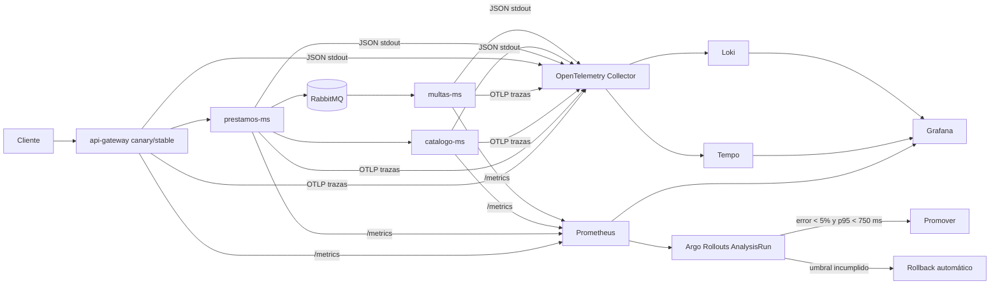

# Práctica 10 — Observabilidad, SLO y entrega progresiva

Toda la documentación de P10 está en este README. Los archivos JSON y PNG de `P10` son artefactos de configuración y evidencia.

Proyecto GCP: `p8202300582` · clúster: `p9-202300582` · zona: `us-central1-a`  
Aplicación: namespace `sa-p9` · observabilidad: namespace `observability`

## Entregables

| Evidencia requerida | Recurso público |
|---|---|
| Repositorio de aplicación | [Practicas-SA-B-202300582](https://github.com/Izabel05/Practicas-SA-B-202300582) |
| Repositorio GitOps | [GItOps_202300582](https://github.com/Izabel05/GItOps_202300582) |
| Servicios instrumentados | `api-gateway`, `prestamos-ms`, `catalogo-ms`, `multas-ms` en `sa-p9` |
| Instrumentación | [P4/Backend](../P4/Backend) |
| OpenTelemetry Collector | [observability-otel-collector.yaml](https://github.com/Izabel05/GItOps_202300582/blob/main/argocd/applications/observability-otel-collector.yaml) |
| AnalysisTemplate | `gateway-slo-prometheus` en [analysis-template.yaml](https://github.com/Izabel05/GItOps_202300582/blob/main/charts/sa-platform/templates/analysis-template.yaml) |
| PromQL de canario | tasa 5xx `< 5 %`; p95 `< 750 ms`, filtrados por `rollouts-pod-template-hash` |
| SLO y PrometheusRule | [observability.yaml](https://github.com/Izabel05/GItOps_202300582/blob/main/charts/sa-platform/templates/observability.yaml) |
| Runbooks | [Disponibilidad](#runbook-de-disponibilidad) · [latencia](#runbook-de-latencia) |
| Dashboard JSON | [sa-p10-golden-signals.json](dashboards/sa-p10-golden-signals.json) |
| Flujo de telemetría | [Diagrama en este README](#arquitectura-y-flujo-de-telemetría) |
| Informe operativo | [Sección de este README](#informe-operativo) |
| Evidencia de GKE y rollback | [Validación en este README](#validación-de-telemetría-en-gke) |
| Imagen de configuración del dashboard | [Evidencia API de Grafana](evidence/grafana-dashboard-api-evidence.png) |
| Video 5–8 minutos | Pendiente de grabación y URL pública por el estudiante |

## Diseño verificable

La cadena `api-gateway → prestamos-ms → catalogo-ms → RabbitMQ → multas-ms` propaga contexto W3C. Los servicios emiten métricas técnicas de tráfico, errores y latencia; métricas de negocio de préstamos, multas y cambios de estado; trazas OTLP; y logs JSON con `trace_id`/`span_id`.

Prometheus recolecta `/metrics` mediante `ServiceMonitor`. El Collector recoge logs de contenedores y trazas OTLP, enviándolos a Loki y Tempo. El dashboard Grafana reúne las cuatro señales doradas, consumo de presupuesto y métricas de negocio.

## SLO

1. **Disponibilidad:** 99.5 % de solicitudes sin 5xx en 30 días; presupuesto de error 0.5 %.
2. **Latencia:** 95 % de solicitudes por debajo de 750 ms en 30 días; presupuesto de error 5 %.

El burn rate se registra como consumo del presupuesto. Las alertas rápidas usan umbral `14.4` durante dos minutos y enlazan a los runbooks.

PromQL de tráfico y latencia:

```promql
sum by (service) (rate(library_http_requests_total[5m]))
```

```promql
histogram_quantile(0.95, sum by (le, service) (rate(library_http_request_duration_seconds_bucket[5m])))
```

**Limitación de la versión actual:** la ausencia de respuestas 5xx produce `No data` en el panel de errores y el presupuesto de disponibilidad, en vez de mostrar cero. El tráfico automático a `/health/catalogo` no crea préstamos ni multas, de modo que el panel de negocio puede quedar vacío. La regla de presupuesto de latencia usa el bucket `le="0.75"`, que solo emite el gateway; catálogo, préstamos y multas carecen de él. Un valor como `9.54` no representa correctamente el presupuesto agregado de los cuatro servicios. Se deben alinear los buckets y publicar nuevas imágenes antes de usarlo como evidencia exacta.

## Demostración de reversión

La falla de P10 introduce latencia en la revisión candidata con `INJECT_LATENCY_MS`. El generador continuo llama al Service canario, Prometheus observa p95 por hash de revisión y Argo Rollouts aborta sin promoverla cuando supera 750 ms. La recuperación se realiza revirtiendo el valor en Git y dejando que Argo CD sincronice el estado sano.

## Arquitectura y flujo de telemetría



La propagación W3C `traceparent` conserva el contexto entre gateway y catálogo y, por headers AMQP, hacia multas. Los logs JSON contienen `trace_id` y `span_id` para navegar entre Loki y Tempo.

## Validación de telemetría en GKE

La versión `v1.2.5` fue construida, analizada y firmada por [GitHub Actions](https://github.com/Izabel05/Practicas-SA-B-202300582/actions/runs/38654115431). En la validación del 14 de octubre de 2026, el Rollout `api-gateway` terminó `Healthy 2/2` con hash `6b8d4465cf`. Prometheus devolvió `up=1` para gateway, catálogo, préstamos y multas. Argo CD mostró la aplicación y la pila de observabilidad `Synced/Healthy`.

La traza `477f050345123797d0336e160cd657b` consultada en Tempo muestra `api-gateway` (SERVER) → solicitud HTTP cliente → `catalogo-ms` (SERVER) con el mismo contexto. Loki devolvió logs JSON de `sa-p9` con `trace_id` y `span_id`; un identificador observado fue `6f99688a07335aa7f1e57a00eb17fae7`. La API de Grafana confirmó UID `sa-p10-golden-signals`, `provisioned=true`, archivo externo `sa-p10-golden-signals.json` y ocho paneles. La [imagen de evidencia](evidence/grafana-dashboard-api-evidence.png) resume esa configuración; no es una captura directa de los paneles con datos en vivo.

| Etapa | Hash candidato | AnalysisRun | Resultado |
|---|---|---|---|
| Línea base sana | `66f69df695` | `api-gateway-66f69df695-5-2`, `-5`, `-8` | `Successful` |
| Falla inducida | `79f85c79fb` | `api-gateway-79f85c79fb-7-5` | `Failed`; p95 `2.411 s` > `0.750 s`; error 5xx `0` |
| Recuperación GitOps | `6b8d4465cf` | `api-gateway-6b8d4465cf-8-2`, `-5`, `-8` | `Successful`; Rollout `Healthy 2/2` |

La latencia candidata de `1200 ms` se declaró en GitOps (`3d914b7`). El AnalysisRun fallido comenzó a las `2026-10-14T23:43:23Z` y terminó a las `23:43:33Z`. **Síntoma → causa → respuesta:** p95 por encima de 750 ms → latencia candidata declarada en Git → detección y aborto en unos 10 segundos, conservando la versión estable. La recuperación también fue declarativa (`cf30d6c`). El acceso anónimo temporal de inspección se retiró en `1616a6a`.

## Informe operativo

El objetivo fue instrumentar al menos tres servicios y observar tráfico, errores, duración, saturación, eventos de negocio, trazas y logs. El gateway y tres microservicios están instrumentados. El Collector y los almacenes de observabilidad corren en GKE; su configuración permanece en GitOps. Grafana permite recorrer las señales doradas y correlacionar una petición mediante `trace_id`.

El `AnalysisTemplate` `gateway-slo-prometheus` evalúa cada candidata filtrando por `rollouts-pod-template-hash`. Exige tasa 5xx inferior a 5 % y p95 inferior a 750 ms en etapas de 20 %, 50 % y 80 %. El experimento de P10 degradó la latencia, distinto del experimento de P8. Prometheus detectó la candidata lenta y Argo Rollouts conservó la versión estable. La recuperación se realizó al revertir el valor en Git y sincronizar Argo CD. El operador debe iniciar en el dashboard, delimitar servicio y revisión, abrir una traza lenta y luego su log, y cerrar el incidente cuando p95 vuelva a su objetivo.

## Runbook de disponibilidad

**Alerta:** `AvailabilityErrorBudgetFastBurn` · **SLO:** 99.5 % sin 5xx en 30 días.

1. Confirmar el alcance con `sa:slo_availability:error_ratio_5m` y revisar las series por servicio, ruta y revisión.
2. Revisar Rollout y AnalysisRun. Si la candidata concentra los 5xx, abortar el Rollout.
3. Buscar en Loki el `trace_id` de una petición fallida y abrirla en Tempo.
4. Validar dependencias, base de datos y RabbitMQ; no promover mientras el burn rate supere 1.
5. Declarar recuperación tras 15 minutos con error bajo 0.5 %; registrar causa y duración.

```bash
kubectl argo rollouts get rollout api-gateway -n sa-p9
kubectl get analysisrun -n sa-p9
kubectl argo rollouts abort api-gateway -n sa-p9
```

## Runbook de latencia

**Alerta:** `LatencyErrorBudgetFastBurn` · **SLO:** 95 % de solicitudes bajo 750 ms en 30 días.

1. Comparar p50, p95 y p99 por servicio, ruta y revisión.
2. Consultar trazas lentas en Tempo e identificar el span dominante.
3. Correlacionar `trace_id` con Loki y revisar CPU, memoria y conexiones de base de datos.
4. Si afecta solo a la candidata, abortar el Rollout; si afecta a ambas, escalar como incidente de plataforma.
5. Verificar p95 menor a 750 ms durante 15 minutos; registrar causa, mitigación y tiempo de recuperación.

## Guion de video (5–8 min)

- 00:00–00:45: arquitectura, repositorios y namespaces.
- 00:45–02:00: instrumentación, propagación y Collector.
- 02:00–03:15: dashboard, SLO, error budget y alertas.
- 03:15–05:30: Rollout, AnalysisRun fallido y rollback automático.
- 05:30–06:30: correlación métrica → traza → log y causa.
- 06:30–07:00: recuperación por GitOps y estado final.

El video y su URL pública están pendientes de grabación por la estudiante. Se recomienda capturar el dashboard real desde `http://localhost:3000` para la entrega. El acceso por Cloud Shell Web Preview produjo `origin not allowed`; un `kubectl port-forward` local evita ese proxy.
