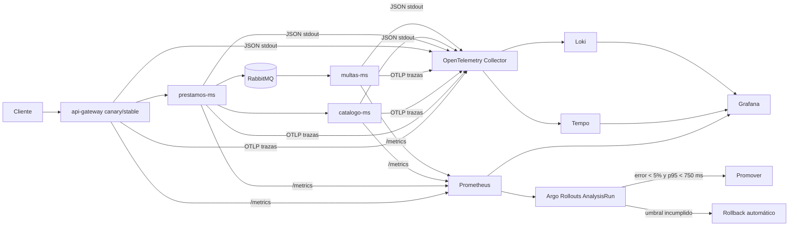

# Flujo de telemetría

La propagación W3C `traceparent` conserva un único contexto desde el gateway hasta catálogo y, mediante headers AMQP, hasta multas. Los logs JSON incluyen `trace_id` y `span_id` para navegar en ambos sentidos entre Loki y Tempo.
